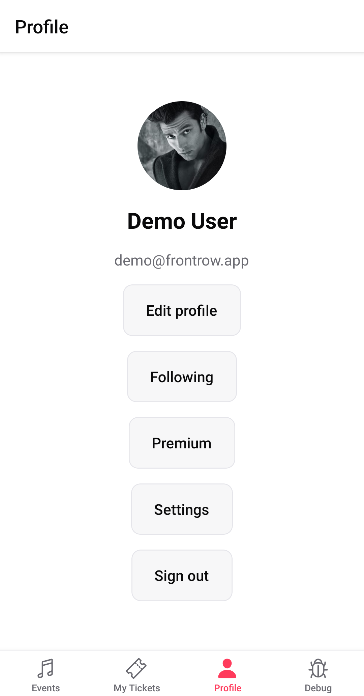

# appium-android

Демо UI-тестов для Android-приложения **FrontRow** (Appium + Selenide + JUnit 5 + Allure).



## Стек

- Java 21 (Gradle toolchain)
- Appium UiAutomator2
- Selenide Appium
- Screen Objects в `src/test/java/mipkasnow/dev/android`

## Что нужно

| Инструмент | Заметки |
|---|---|
| JDK 21 | Toolchain проекта |
| Android SDK | `ANDROID_HOME`, в `PATH` — `platform-tools` и `emulator` |
| Эмулятор (AVD) | В скрипте по умолчанию AVD `Pixel_5` |
| Node.js + Appium | `npm i -g appium` и `appium driver install uiautomator2` |
| Плагин Inspector (опционально) | Для `scripts/run_appium_inspector.sh` |

### Android Studio

1. Установи [Android Studio](https://developer.android.com/studio).
2. **Settings → Languages & Frameworks → Android SDK** — поставь Platform Tools, Emulator, нужный system image (например API 30+).
3. **Device Manager** → Create Device → например Pixel 5 → скачай image → имя AVD лучше `Pixel_5` (так ждёт скрипт).

Системный Gradle не обязателен — в проекте используется `./gradlew`.

## Минимальный `~/.zshrc` (Mac Apple Silicon)

Обезличенный пример без секретов. Подставь свой путь к SDK, если он другой.

```zsh
eval "$(/opt/homebrew/bin/brew shellenv)"

export JAVA_HOME="$(/usr/libexec/java_home -v 21 2>/dev/null || /usr/libexec/java_home)"
export PATH="$JAVA_HOME/bin:$PATH"

export ANDROID_HOME="$HOME/Library/Android/sdk"
export ANDROID_SDK_ROOT="$ANDROID_HOME"
export PATH="$PATH:$ANDROID_HOME/emulator:$ANDROID_HOME/platform-tools"
[ -d "$ANDROID_HOME/cmdline-tools/latest/bin" ] && export PATH="$PATH:$ANDROID_HOME/cmdline-tools/latest/bin"

export NVM_DIR="$HOME/.nvm"
[ -s "$NVM_DIR/nvm.sh" ] && . "$NVM_DIR/nvm.sh"

export PATH="$HOME/.local/bin:$PATH"

autoload -Uz compinit && compinit
```

После правок открой новый терминал или выполни `source ~/.zshrc`.

## Проверка перед запуском

```bash
java -version          # 21.x
echo "$ANDROID_HOME"   # .../Library/Android/sdk
adb version
emulator -version | head -1
emulator -list-avds    # должен быть Pixel_5 (или поменяй AVD_NAME)
node -v
npm -v
appium -v
appium driver list --installed   # uiautomator2
```

Установка Appium (если ещё нет):

```bash
npm i -g appium
appium driver install uiautomator2
```

## Запуск локально

1. Поднять эмулятор и Appium (AVD `Pixel_5`, порт `4723`):

```bash
./scripts/run_emulator_and_appium.sh
```

Другой AVD:

```bash
AVD_NAME=My_AVD ./scripts/run_emulator_and_appium.sh
```

2. В другом терминале прогнать тесты:

```bash
./gradlew test
```

APK: `src/test/resources/apk/FrontRow.apk` (пакет `app.frontrow.qa`).

## Что покрыто

- Логин (демо-пользователь и невалидные креды)
- Редактирование профиля (имя / био)
- Способы оплаты (добавление / удаление карты)
- Отзывы (оценка + фото)
